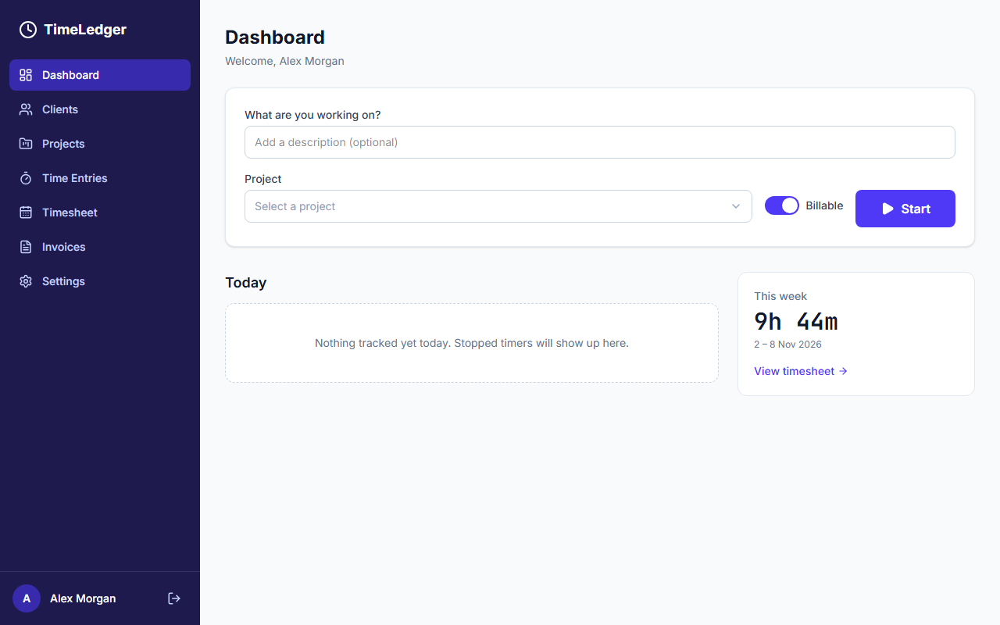
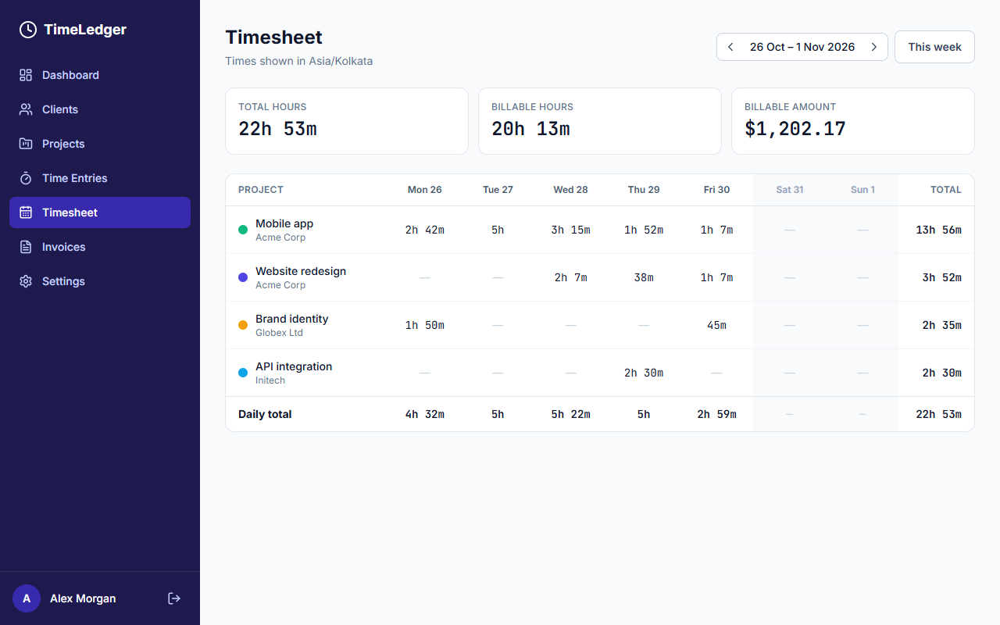
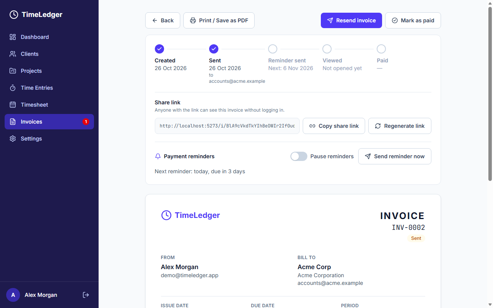
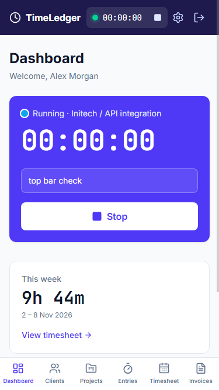
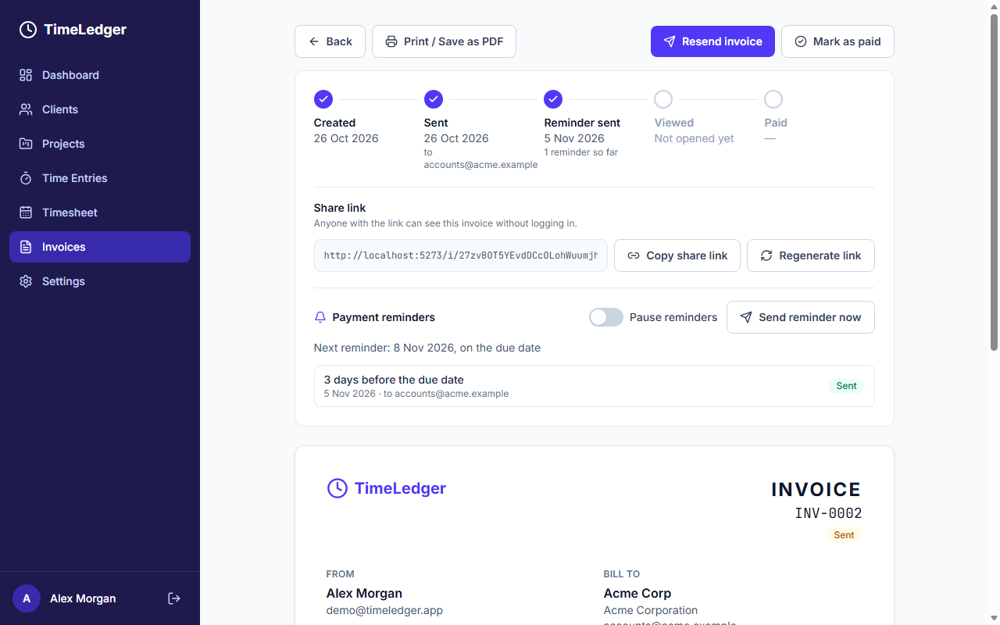
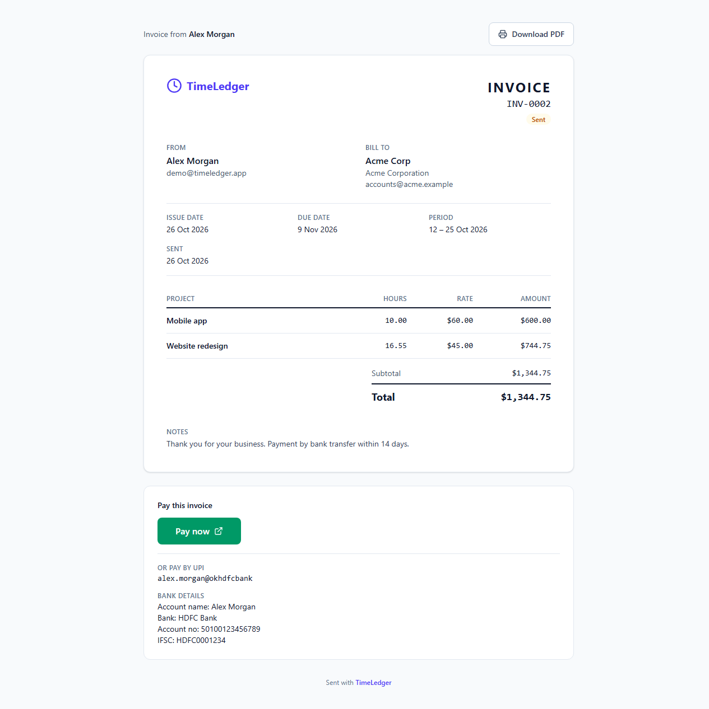
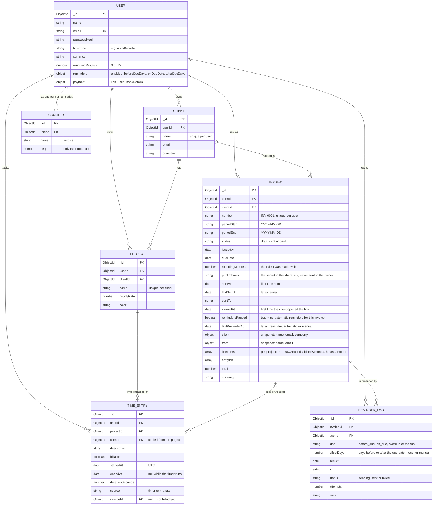

# TimeLedger

A time tracker with invoicing for freelancers: track time with a timer that lives on the server, turn unbilled time into printable invoices, and never bill the same hour twice. Built with the MERN stack (MongoDB, Express, React, Node.js).

**Live site:** press **Sign up** and create your own account. There is no shared demo login on the live site; the demo data is for running the app locally (see [Try it](#try-it)).

<table>
  <tr>
    <td width="50%"><a href="docs/test-evidence/screenshots/step-8-seed-and-rounding/01-demo-dashboard-desktop.png"></a><br><sub><b>Dashboard</b>: start a timer, today's entries, this week</sub></td>
    <td width="50%"><a href="docs/test-evidence/screenshots/step-8-seed-and-rounding/02-demo-timesheet-desktop.png"></a><br><sub><b>Timesheet</b>: hours per project per day</sub></td>
  </tr>
  <tr>
    <td width="50%"><a href="docs/test-evidence/screenshots/step-8-seed-and-rounding/05-demo-invoice-sent-desktop.png"></a><br><sub><b>Invoice</b>: printable, Print / Save as PDF</sub></td>
    <td width="50%"><a href="docs/test-evidence/screenshots/step-8-seed-and-rounding/15-running-timer-top-bar-mobile.png"></a><br><sub><b>Phone</b> (375px): running timer in the top bar</sub></td>
  </tr>
  <tr>
    <td width="50%"><a href="docs/test-evidence/screenshots/phase-1b-reminders-and-payment/05-invoice-reminder-sent-desktop.png"></a><br><sub><b>Reminders</b>: the next one, the history, pause, send now</sub></td>
    <td width="50%"><a href="docs/test-evidence/screenshots/phase-1b-reminders-and-payment/08-public-pay-now-desktop.png"></a><br><sub><b>Pay now</b>: what the client sees under the invoice</sub></td>
  </tr>
</table>

More screenshots, every test result and the test code are in [docs/test-evidence](docs/test-evidence) (open [test-report.html](docs/test-evidence/test-report.html) in a browser for the whole report on one page).

## Contents

[Try it](#try-it) · [Features](#features) · [Tech stack](#tech-stack) · [Setup and run](#setup-and-run) · [Payment reminders](#payment-reminders-and-the-hourly-job) · [Data model](#data-model) · [Design decisions](#main-design-decisions) · [Tests](#tests) · [Finished and not finished](#what-is-finished-and-what-is-not) · [AI tools used](#ai-tools-used) · [API](#api) · [Project structure](#project-structure) · [Troubleshooting](#troubleshooting)

## Try it

**On the live site:** press **Sign up** and create your own account with your e-mail address and a password (at least 8 characters). There is no shared demo account there: everybody starts with an empty account, so add a client and a project, start a timer and make your first invoice.

**With demo data, on your own computer:** the demo data is made locally, with `npm run seed` in `backend/` (see [Setup and run](#setup-and-run)). The seed only runs against a **local** database (or with `SEED_ALLOW=true`), so it never puts a demo user into a deployed app. After seeding, log in with this local demo account (the login page only shows it as a hint when the frontend is started with `VITE_SHOW_DEMO=true`):

| Email | Password |
| --- | --- |
| `demo@timeledger.app` | `Demo@1234` |

The demo user, Alex Morgan (time zone Asia/Kolkata, USD), has 3 clients (Acme Corp, Globex Ltd, Initech), 4 projects, about four weeks of time entries placed relative to today, three invoices (a **paid** one for Globex, a **sent** one for Acme that is not due yet, and a **sent** one for Initech that is **overdue**, by 7 to 13 days depending on the weekday, so the overdue alert and the aging bar have something to show). The last two weeks are left unbilled, so you can create an invoice right away. Nothing is running: start a timer yourself. To try the rounding rule, see [Rounding](#rounding-each-entry-up-to-15-minutes). The demo user also has payment reminders switched on and fake payment details (a `pay.example.com` link, a UPI ID and bank details), so e-mails and the public invoice page show a **Pay now** button; see [Payment reminders](#payment-reminders-and-the-hourly-job).

## Features

**Core features**

- [x] **Clients and projects** with an hourly rate (and a colour); every record belongs to one user and someone else's record answers `404`
- [x] **Start/stop timer**: only one at a time, and it survives a refresh and closing the browser; a running indicator shows in the sidebar (top bar on phones) and in the browser tab title
- [x] **Manual time entries**: add and edit entries by hand, marked billable or not (they can also be deleted; the Time entries page has filters and totals)
- [x] **Weekly timesheet**: hours per project per day, Monday to Sunday, with daily and weekly totals; an entry that crosses midnight is split between the days
- [x] **Invoices**: for a client and a date range, made from the unbilled billable entries, with a live preview of exactly what will be billed; a **printable page / PDF** (Print / Save as PDF hides the sidebar, bars and buttons); the entries **become billed** and are locked

**The two points that were evaluated closely**

- [x] **The running timer is stored on the server**: it is correct across devices and after a refresh (and after closing the browser); only one timer per user, guaranteed by the database
- [x] **An entry can never appear on two invoices**, not even when two requests arrive at the same moment (claim-first update inside a transaction; concurrency tests and a mutation check)

**Stretch features** (both done)

- [x] **Rounding rule**: optionally round each entry up to 15 minutes, only when billing
- [x] **Mark invoices as sent or paid**: Draft → Sent → Paid; delete a draft to give its entries back (invoice numbers are never reused)

**Phase 1A (the SaaS version)**

- [x] **Send an invoice by e-mail**: *Send invoice* on the invoice page (To filled in with the client's e-mail, CC, a personal message); the e-mail has a big **View invoice** button, and the invoice becomes *Sent*. Local development only logs the e-mail ([how to try it](#sending-invoices-by-e-mail)); Brevo sends real ones.
- [x] **Public invoice link**: the client opens `/i/<token>` without logging in and sees the invoice (Download PDF, no sidebar). The owner can copy or regenerate the link (the old one stops working) and sees a timeline: Created, Sent (when, to whom), Viewed, Paid.
- [x] **Overdue**: an invoice that was sent and is past its due date is shown as **Overdue** (red, "5 days overdue"), with an Overdue filter and the overdue amount under Outstanding. It is worked out each time, never stored.

**Phase 1B (the SaaS version)**

- [x] **Automatic payment reminders** for invoices that were sent and are not paid: *N days before* the due date, *on* it and *N days after* (by default 3 days before, on the day, and 7 and 14 days after; everybody chooses in Settings). The e-mail is friendly ("Reminder: INV-0003 is due in 3 days") and has the amount, the due date and a **View invoice** button. Nothing runs inside the server (Render's free tier sleeps): an **hourly GitHub Action** calls a protected endpoint ([how to run it](#payment-reminders-and-the-hourly-job)).
- [x] **Reminders on the invoice page**: the next reminder ("Next reminder: 12 Nov 2026, due in 3 days"), the history (date, to whom, sent or failed), *Pause reminders* for one invoice, *Send reminder now* (once per 24 hours), a *Reminder sent* step in the timeline, and a bell in the invoices list.
- [x] **Payment details and Pay now**: in Settings add a payment link (a Stripe, PayPal or Razorpay URL), a UPI ID and bank details, all optional and validated. The invoice e-mail, the reminder e-mails and the client's public page then show a green **Pay now** button (only when there is a link) and the UPI ID and bank details below it.

**Phase 1C (the SaaS version): who owes me what**

- [x] **Overdue alert and Money cards on the dashboard**: a red banner at the top while anything is overdue ("2 invoices overdue · $1,344.75", the oldest one, a *View overdue* button; dismissible for the day), then Outstanding, Overdue, Paid this month and Avg. days to get paid, and one stacked **aging bar** of the unpaid invoices (Current, 1–30, 31–60, 61+ days overdue) with the amounts in a legend. A red number on *Invoices* in the sidebar (and on the phone's bottom bar) counts the overdue invoices.
- [x] **Clients as "who owes me what"**: every client shows what is outstanding, what is overdue (red, with the days), what is not billed yet and the last payment, with a status (*All paid*, *Owes $X*, *Overdue*), sorted overdue first, plus a *Owes me money* filter.
- [x] **A page for each client** (`/clients/:id`): the contact, four metric cards, the invoices with their status, the last payments, *New invoice* with the client filled in, and *Invoice unbilled time*, which also fills in the days of the unbilled time. How the numbers are worked out, and how to see all of it with the demo data: [Who owes me what](#who-owes-me-what).

**Also in the app** (supporting the above, not part of the brief)

- Accounts: register and log in (bcrypt-hashed passwords, JWT), protected routes, the session survives a reload
- Time zones: everything is stored in UTC and days, weeks and invoice periods follow your own time zone (daylight saving included)
- Responsive layout: sidebar on desktop, top bar and bottom tab bar on phones (checked at 375px)
- A Settings page (name, time zone, the rounding switch, payment reminders, payment details) and demo seed data (`npm run seed`)

### Rounding each entry up to 15 minutes

Go to **Settings**, switch on *Round each entry up to 15 minutes* and save. From then on, creating an invoice rounds **each entry** up to the next 15 minutes (7 min → 15 min, 22 min → 30 min; exactly 15 min stays 15 min; one second more goes to 30). The new-invoice preview says *Rounded up to 15 min per entry* and shows the tracked and the billed time; the invoice page shows the same note and, per entry, `7m → 15m`. Your tracked time is never changed, and invoices you made earlier are not affected by switching it on or off.

## Tech stack

- **Backend:** Node.js (ES modules), Express 5, MongoDB with Mongoose 9, Zod 4 (validation), JSON Web Tokens, bcryptjs, Luxon (time zone maths)
- **Frontend:** React 19, Vite, Tailwind CSS 4, React Router, Axios, lucide-react icons, react-hot-toast
- **Tests:** Jest, Supertest and mongodb-memory-server (backend); Puppeteer driving Microsoft Edge (browser checks)

## Setup and run

**Prerequisites:** Node.js 20+ (20.19+ or 22.12+ for the current Vite) and a MongoDB database that supports **transactions**: a free [MongoDB Atlas](https://www.mongodb.com/atlas) cluster, or a local MongoDB running as a **replica set**. Invoices are created in a transaction (that is what makes double billing impossible); a plain local `mongod` answers `503` when an invoice is created.

1. **Get the code and install**

   ```bash
   git clone https://github.com/jagga-123/timeledger.git
   cd timeledger/backend && npm install
   cd ../frontend && npm install
   ```

2. **Configure the backend**: copy `backend/.env.example` to `backend/.env` (`cp` on macOS/Linux, `copy` on Windows) and fill in `MONGODB_URI` and `JWT_SECRET`.

   - *Atlas:* paste your connection string, with the database name, for example `mongodb+srv://<user>:<password>@<cluster>/timeledger`.
   - *Local MongoDB as a replica set:* start it with `mongod --replSet rs0 --dbpath <folder>`, run `rs.initiate()` once in `mongosh`, and use `mongodb://127.0.0.1:27017/timeledger?replicaSet=rs0`.

3. **(Optional) create the demo data**

   ```bash
   cd backend
   npm run seed
   ```

   It prints what it created. Run it as often as you like: it deletes and recreates **only** the demo user's data and never touches anybody else's. It refuses to run when `MONGODB_URI` is not a local database (anything but `localhost` or `127.0.0.1`, so never against Atlas) or when `NODE_ENV=production`, unless `SEED_ALLOW=true` is also set.

4. **Start the app** (two terminals)

   ```bash
   cd backend  && npm run dev    # API on http://localhost:5000  (check http://localhost:5000/api/health)
   cd frontend && npm run dev    # app on http://localhost:5173
   ```

   Open http://localhost:5173, then register, or, if you ran the seed, log in as the demo user (see [Try it](#try-it)).

5. **Run the tests:** `cd backend && npm test` (uses a throwaway in-memory database, never yours).

### Environment variables

`backend/.env` (the same variables as `backend/.env.example`)

| Variable | Required | Example value in `.env.example` | Description |
| --- | --- | --- | --- |
| `PORT` | no | `5000` | API port |
| `NODE_ENV` | no | `development` | `development` locally, `production` on the host. In production an unset `EMAIL_PROVIDER` is an error and `npm run seed` refuses to run |
| `MONGODB_URI` | yes | `mongodb://127.0.0.1:27017/timeledger` | MongoDB connection string, with the database name. Use Atlas or a replica set (see above) |
| `JWT_SECRET` | yes | `replace-with-a-long-random-string` | Long random string used to sign tokens |
| `JWT_EXPIRES_IN` | no | `7d` | How long a login lasts |
| `FRONTEND_URL` | no | `http://localhost:5173` | Allowed CORS origin: the address of the frontend |
| `APP_URL` | no | *(empty)* | The address of the app in the links inside e-mails (`<APP_URL>/i/<token>`); empty means `FRONTEND_URL` |
| `EMAIL_PROVIDER` | no | `console` | `console` logs e-mails and sends nothing (the default while developing); `brevo` sends them through Brevo |
| `BREVO_API_KEY` | with `brevo` | `replace-with-your-brevo-api-key` | Your Brevo API key |
| `EMAIL_FROM` | with `brevo` | `replace-with-your-verified-sender@example.com` | The sender address you verified in Brevo |
| `EMAIL_FROM_NAME` | no | `TimeLedger` | The name shown with the sender address (an e-mail says "Alex Morgan via TimeLedger") |
| `CRON_SECRET` | for reminders | `replace-with-a-long-random-string-for-the-scheduler` | The shared secret the scheduler sends in the `X-Cron-Secret` header to run the payment reminders (at least 16 characters). While it is empty or still the placeholder, the endpoint answers `503` and nothing runs. See [Payment reminders](#payment-reminders-and-the-hourly-job) |
| `DEMO_EMAIL` | no | `demo@timeledger.app` | The e-mail of the demo user that `npm run seed` creates |
| `DNS_SERVERS` | no | *(empty)* | Comma-separated DNS servers used to look up `mongodb+srv://` hosts; empty means `8.8.8.8,1.1.1.1` |

`frontend/.env` (the same variable as `frontend/.env.example`)

| Variable | Required | Example value in `.env.example` | Description |
| --- | --- | --- | --- |
| `VITE_API_URL` | no | `http://localhost:5000/api` | API base URL including `/api` |
| `VITE_SHOW_DEMO` | no | `false` | `true` shows the "Demo: demo@timeledger.app / Demo@1234" hint on the login page. Leave it `false` anywhere real people log in; set it to `true` locally after `npm run seed` |

`SEED_ALLOW` is not in `.env.example`: it is only read by `npm run seed` (see step 3). Never commit a real `.env`: it is git-ignored, and `.env.example` only contains placeholders.

### Scripts

| Where | Command | What it does |
| --- | --- | --- |
| `backend/` | `npm run dev` | Start the API with auto-restart (nodemon) |
| `backend/` | `npm start` | Start the API |
| `backend/` | `npm run seed` | Create or reset the demo user and her data |
| `backend/` | `npm test` | Run the backend tests |
| `frontend/` | `npm run dev` | Start the Vite dev server |
| `frontend/` | `npm run build` | Production build into `dist/` |
| `frontend/` | `npm run preview` | Serve the production build locally |

### Sending invoices by e-mail

**Locally (the `console` provider, the default).** Nothing is sent. Start the backend, open an invoice, press **Send invoice** and then **Send**. The e-mail is printed in the terminal where the backend runs (to, CC, subject and the text version with the link), and the invoice becomes *Sent*. Open the printed link `http://localhost:5173/i/<token>` (or press *Copy share link* on the invoice page) in a private window to see what the client sees. A `.env` without `EMAIL_PROVIDER` does the same in development.

**Real e-mails with Brevo** (free tier, no domain needed, but a verified sender address):

1. Make a free account at [brevo.com](https://www.brevo.com).
2. Verify a sender: *Senders, Domains & Dedicated IPs* → *Senders* → *Add a sender*, use your own e-mail address and click the link Brevo sends you. (E-mails sent from a free address such as Gmail may land in spam; for real use, authenticate a domain.)
3. Make an API key: your name (top right) → *SMTP & API* → *API Keys* → *Generate a new API key*. Copy it once; it is not shown again.
4. In `backend/.env` set:

   ```
   EMAIL_PROVIDER=brevo
   BREVO_API_KEY=<your API key>
   EMAIL_FROM=<the sender address you verified>
   EMAIL_FROM_NAME=TimeLedger
   APP_URL=<where the app is open, for example http://localhost:5173>
   ```

5. Restart the backend and send an invoice to **your own address** first. Replies from the client go to the freelancer's address (Reply-To), not to the sender address.

If Brevo answers `401` about an unrecognised IP address, add your server's IP under *Security* → *Authorised IPs* or turn IP blocking off. The app then shows "Couldn't send the email. Try again." and leaves the invoice unchanged; the reason is in the backend's output (never the API key). In production an unset `EMAIL_PROVIDER` is an error rather than a silent log, so an invoice is never marked as sent by an e-mail that was only logged.

### Payment reminders and the hourly job

**What is sent.** For every invoice that was sent and is not paid, the client gets an e-mail *N days before* the due date, *on* the due date and *N days after* it. Everybody chooses in **Settings → Payment reminders**: a master switch, 0 to 14 days before (0 means none), the due date itself, and after the due date any of 7, 14 and 30 days (the defaults are 3 days before, on the due date, and 7 and 14 days after). The subjects are `Reminder: INV-0003 is due in 3 days`, `INV-0003 is due today` and `INV-0003 is 7 days overdue`. The e-mail has the amount, the due date, a **View invoice** button and, when payment details are set up in Settings, **Pay now** and the UPI ID and bank details below it. Replies go to the freelancer (Reply-To).

**The rules** (every one of them has a test):

- The day is the **owner's** day (their time zone), not the server's.
- Nothing is scheduled on or before the day the invoice was (last) sent, so a freshly sent invoice is not reminded the same day.
- A reminder that was missed (the server was asleep or down) is still sent up to **2 days late**, but only the **latest** missed one, never a burst of old ones. The wording follows the real situation ("is due in 1 day", "is 1 day overdue").
- Nothing is sent for draft or paid invoices, paused invoices, a client without an e-mail address, or when the owner switched reminders off.
- A reminder is **claimed in the database first** (a unique index) and sent afterwards, so two runs at the same moment, or calling the job again and again, send one e-mail. A failed e-mail is logged as *failed* and the next run tries again (3 attempts at most); the invoice itself never changes.
- *Send reminder now* on the invoice page is limited to one per invoice per 24 hours (`429 You already sent a reminder in the last 24 hours`), and an automatic reminder waits 24 hours after a manual one.

**Why an external scheduler.** Render's free tier puts the server to sleep, so `node-cron` or `setInterval` inside the server would not run when it is needed. Instead, `POST /api/cron/reminders` does one pass and an hourly **GitHub Action** ([.github/workflows/reminders.yml](.github/workflows/reminders.yml), at minute 17 of every hour) calls it. Calling it more often is harmless. It answers `{ checked, sent, skipped, failed, ranAt }`.

**Run the job on your own computer** (with the backend running, for example `npm run dev`):

1. Make a secret and put it in `backend/.env`, then restart the backend:

   ```bash
   node -e "console.log(require('crypto').randomBytes(32).toString('hex'))"
   ```

   ```
   CRON_SECRET=<the value that was printed>
   ```

   While `CRON_SECRET` is empty, shorter than 16 characters or still the placeholder, the endpoint answers `503`; a wrong or missing header is `401`.

2. Call the endpoint with the secret. With `EMAIL_PROVIDER=console` the e-mails are printed in the backend's terminal and nothing is sent:

   ```bash
   curl -X POST -H "X-Cron-Secret: <your secret>" http://localhost:5000/api/cron/reminders
   # {"checked":1,"sent":1,"skipped":0,"failed":0,"ranAt":"2026-11-05T09:00:00.000Z"}
   ```

   (In Windows PowerShell write `curl.exe`, because `curl` there is a different command.)

3. To see a reminder: open a *sent* invoice (the demo user has one) and press **Send reminder now**; the e-mail appears in the terminal. For the automatic job to send something, an invoice needs a reminder day that is today, for example a due date exactly 3 days away with the default settings. No screen changes a due date, so for a try-out change `dueDate` of a sent invoice in the database.

**Set up the GitHub Action** (once the backend is deployed):

1. On the server (for example Render → *Environment*) set `CRON_SECRET` to a long random value (make one with the command above).
2. In the GitHub repository open **Settings → Secrets and variables → Actions → New repository secret** and add two secrets:
   - `REMINDERS_URL`: the full address of the endpoint, for example `https://your-backend.onrender.com/api/cron/reminders`
   - `CRON_SECRET`: exactly the same value as on the server
3. GitHub only runs scheduled workflows (and shows *Run workflow*) for the **default branch** (`main`), which is where the workflow file is.
4. Try it: **Actions → Payment reminders → Run workflow**. A green run whose log shows `{"checked":...,"sent":...}` works. `401` means the two secrets differ, `503` means the server has no `CRON_SECRET`, and a failed run with a timeout means the server did not wake up (the workflow waits up to 3 minutes and retries 3 times, which is enough for Render's cold start).
5. GitHub can start a scheduled run a few minutes late, and it pauses scheduled workflows of a public repository after 60 days without any activity (switch it on again in the Actions tab).

### Who owes me what

The dashboard, the Clients page and the sidebar badge all answer one question: who owes you money, and how late is it. Everything is worked out each time from your own invoices and time entries, in your own time zone (nothing is stored). Only **sent** and **paid** invoices count: a draft has not been asked for yet.

| Number | What it is |
| --- | --- |
| **Outstanding** | the total of every invoice that was sent and is not paid |
| **Overdue** | the part of it that is past its due date. **Due today is not overdue yet**: it is *Current* |
| **Paid this month** | what was paid since the 1st of this month (in your time zone), by the date the invoice was marked as paid |
| **Avg. days to get paid** | from the day an invoice was sent to the day it was paid (whole calendar days), over the invoices paid in the last 90 days. A client's own average covers all of their payments |
| **Aging** | the unpaid invoices by how late they are: Current (not due, or due today), 1–30, 31–60 and 61+ days overdue |
| **Unbilled** | billable, finished time entries that are on no invoice yet, at each project's hourly rate and the tracked time (the rounding rule only applies when an invoice is made) |

**Check it with the demo data**

1. Locally: `cd backend && npm run seed` (it needs a local database), start the app and log in as `demo@timeledger.app` / `Demo@1234`.
2. **Dashboard**: a red banner "1 invoice overdue · $148.50" with "Oldest: Initech, N days" (N is 7 to 13, depending on the weekday), the Money cards, the aging bar (Acme's invoice is *Current*, Initech's is *1–30 days*) and a red **1** next to *Invoices* in the sidebar. The **X** hides the banner for today; **View overdue** opens the Invoices with the Overdue filter on.
3. **Clients**: Initech first with a red *Overdue* and its days, then Acme Corp (*Owes $1,344.75*), then Globex Ltd (*All paid*, with the date of its payment). Try *Sort by* and the *Owes me money* chip. Every client also has unbilled time.
4. Click **Acme Corp**: four metric cards, its invoice, and *Invoice unbilled time* (it opens *New invoice* with Acme and the exact days of the unbilled time, and the total is the *Unbilled* card).
5. Open Initech's invoice (INV-0003) and press **Mark as paid**: the badge in the sidebar goes at once, and the dashboard shows Overdue $0.00 and the payment under *Paid this month*.

*Paid this month* is $0.00 at first unless the Globex payment (about two to three weeks ago) falls in the current month. The 31–60 and 61+ buckets are empty in the demo: the tests cover them, and the browser checks fill them by moving due dates in a throwaway database (no screen changes a due date).

## Data model



- **User**: the account and its settings: time zone (follows the device), currency, the rounding rule, the reminder settings and the payment details (link, UPI ID, bank details).
- **Client** and **Project**: what the time is for. A project has the hourly rate; a client name is unique per user and a project name unique per client (case-insensitive).
- **TimeEntry**: one block of time. A **running timer is an entry with `endedAt: null`**; `invoiceId` is `null` until the entry is billed, and an entry with an invoice cannot be edited or deleted.
- **Invoice**: the bill. It stores a **snapshot** (client, sender, rates, lines, period, time zone, rounding rule), so later changes to a client or a rate never change it, plus the ids of the entries it contains, and how it was sent and shared (`publicToken`, `sentAt`, `lastSentAt`, `sentTo`, `viewedAt`). "Overdue" is not stored: it is worked out from `status` and `dueDate`. The reminder state is two fields: `remindersPaused` and `lastReminderAt`.
- **Counter**: one per user, the last invoice number handed out.
- **ReminderLog**: one row per reminder: which invoice, which kind (3 days before, on the due date, 7 days after... or sent by hand), to whom, and whether it was sent or failed. A **unique index** on invoice, kind and day offset is what makes sure a scheduled reminder is sent once; manual reminders have no offset, so they are not limited by it.

## Main design decisions

- **The timer lives on the server.** The running timer is a time entry with `endedAt: null`, so it is correct after a refresh, after closing the browser and on another device. A *partial unique index* (one entry per user where `endedAt` is null) makes the **database** guarantee one timer per user, even if two devices press Start at the same moment (the loser gets `409`). `startedAt` comes from the server's clock, and the browser works out the elapsed time as `now - startedAt` corrected by the offset between its clock and the server's (every response carries `serverTime`), so a device with a wrong clock still shows the right time. It re-syncs when the tab becomes visible again and every 30 seconds, so a timer stopped on another device shows up. Stop is one atomic update that only matches a still-running timer.
- **No double billing.** Creating an invoice first **claims** the entries with one `updateMany` whose filter only matches entries that are still unbilled (`invoiceId: null`) and sets their `invoiceId`; then it builds the invoice from exactly the entries it claimed. The claim, the next invoice number and the invoice are saved in **one MongoDB transaction**, so it is all or nothing. Why not "read the entries, then mark them"? Two simultaneous requests would read the same entries and both bill them; with the claim, one of them finds nothing left (`400`). Billed entries are locked. This is covered by concurrency tests (two identical requests, eight at once, overlapping periods) and a mutation check, see [Tests](#tests).
- **Time zones.** Times are stored in UTC; days, weeks and invoice periods are computed in the user's own time zone with Luxon's calendar arithmetic (not "24 hours × days"), so a daylight saving day is correctly 23 or 25 hours long and an entry that crosses midnight is split between the two days in the timesheet. The server never uses its own zone for this.
- **Invoices are snapshots; numbers come from a counter; rounding happens at billing time.** Invoices copy the client, the sender, the rates and the lines, so history never changes. Numbers (`INV-0001`...) come from a per-user counter incremented inside the same transaction, so they are never reused, even after a draft is deleted. Each line is `hours × rate` rounded to cents and the total is the sum of those rounded lines, so the printed lines always add up. The rounding rule is applied only when an invoice is created: the entries keep their real durations, and the invoice stores the rule plus `rawSeconds` and `billedSeconds` per line.
- **Public share links.** The client must see an invoice without an account, so the link carries the proof: a token of 24 random bytes (192 bits, impossible to guess) that identifies one invoice. The public answer is built field by field from a short list of what the client needs, so a field added to the invoice later can't leak by accident; no user id, entry id or other internal id is ever in it. The route is rate limited, answers `404` for anything unknown, is not cached or indexed, and the first view is recorded without ever being overwritten. The server trusts one proxy hop (`trust proxy` is 1), so the limit counts each visitor's real address and not the proxy's, and a faked `X-Forwarded-For` doesn't help. Regenerating replaces the token, so the old link dies at once. **Overdue** is computed from the due date in the owner's own time zone each time (a stored flag would be wrong the next morning), and an e-mail that fails changes nothing: the invoice is marked as sent only after the provider accepted it.
- **Who owes me what is worked out, not stored.** Outstanding, overdue, the aging buckets, "paid this month" and the average days to get paid are computed from the invoices every time: a stored "overdue" flag or a running total would be wrong the next morning, and could disagree with the invoices list. They use the one overdue rule of the app (a sent invoice past its due date in the owner's time zone; due today is still current), the owner's calendar for "this month" and for counting days, and money is rounded to cents only at the end. Every query starts from the logged-in user, and another user's client is a `404` exactly like a missing one. The unbilled amount comes from the entries themselves (billable, finished, on no invoice), so the number on a client's page is the total the "Invoice unbilled time" preview shows.
- **Reminders without a scheduler inside the server.** Render's free tier sleeps, so a timer in the server cannot be trusted; an hourly GitHub Action calls `POST /api/cron/reminders`, which proves itself with a shared secret (compared in constant time, refused outright while the secret is missing or still the placeholder). One pass looks at every sent, unpaid invoice and works out the owner's *today* with Luxon (a New York owner is a day behind a Kolkata owner for part of every day). Each reminder is **claimed** with an insert that the unique index allows only once, and only then e-mailed, so the job can run twice, or two runs can overlap, and still send once; a failed e-mail marks its row *failed* so the next run can retry it (at most 3 times) without ever sending a second copy. If the server was away, only the latest missed reminder within 2 days goes out. *Send reminder now* is limited to once in 24 hours by an atomic update on the invoice, so two clicks at the same moment send one e-mail, and the limit is given back if the e-mail fails.
- **Payment details are validated and escaped.** A payment link must be a full `https://` address without a password in it (so a Pay now button can never run script or leak a login), a UPI ID must look like `name@bank`, bank details are plain text; an empty value removes one. The public invoice shows the owner's *current* details, only while the invoice is unpaid, and the e-mails escape everything the owner typed.
- **Validation and privacy.** Every route validates its input with Zod and answers errors in one shape, `{ message, errors? }`. Every record has an owner and a record that is someone else's looks like a missing one (`404`), so nobody can find out what exists.

## Tests

```bash
cd backend && npm test
```

**314 backend tests** (Jest + Supertest) on a throwaway in-memory MongoDB, so they never touch a real database. The invoice and seed tests use an in-memory *replica set* because they need transactions.

| File | Tests | Covers |
| --- | --- | --- |
| `health.test.js` | 2 | health route and JSON 404 |
| `auth.test.js` | 15 | register, login, `/me`, validation, duplicate email; `PATCH /auth/me` for time zone, name and the rounding setting |
| `clients-projects.test.js` | 18 | CRUD, duplicate names, per-user isolation, delete rules, rate validation and rounding |
| `timer.test.js` | 25 | server-side start time, one timer per user (including simultaneous requests and the index itself), stop and duration, editing the running timer |
| `entries.test.js` | 28 | manual entries, the time rules, editing and deleting, billed entries locked, filters and totals |
| `timesheet.test.js` | 24 | days and week edges, splitting across midnight, daylight saving weeks, totals |
| `invoices.test.js` | 36 | which entries are billed, line items and rounding, snapshots, **an entry never on two invoices (two identical requests, eight at once, overlapping periods, two users)**, all or nothing, the `503` without transactions, time zone day boundaries, numbering, the status flow, deleting a draft, privacy; the rounding rule on invoices |
| `rounding.test.js` | 6 | `roundUp`: 1 s → 15 min, 15 min → 15 min, 15 min 1 s → 30 min, 0 stays 0, never rounds down |
| `seed.test.js` | 7 | running the seed twice gives identical data, it leaves another user's data untouched, the demo user gets reminders and payment details, the production guard, and the guard against a database that is not local (which connection strings count as local, including the tricks, the `SEED_ALLOW` override, a message that never repeats the connection string, and `npm run seed` itself stopping before it connects) |
| `invoice-send.test.js` | 21 | sending (draft to sent, the e-mail the provider gets, typed recipient, CC, message escaped, the client's current address), no client e-mail `400`, validation, paid `409`, a failing provider `502` with the invoice untouched, sending again, privacy; the Brevo request and failures (network faked); overdue (due yesterday in Asia/Kolkata, due today, N days, paid and draft never, New York, the list and its filters) |
| `public-invoice.test.js` | 20 | the public answer holds only what the client needs, no private data anywhere, not cached or indexed, real states, every kind of unknown token `404`, `viewedAt` set once, one token even for simultaneous requests, regenerate kills the old link, privacy between users, the rate limit, and the rate limit behind one proxy (each visitor counted by the address the proxy reports; faking `X-Forwarded-For` does not help) |
| `payment.test.js` | 25 | saving the payment details (link, UPI ID, bank details) through `PATCH /auth/me`: only what is sent changes, an empty string removes one, the text is cleaned; the validation (https only, so no `javascript:`, `http:`, passwords or spaces; real Stripe, PayPal and Razorpay links; the UPI format; the length limits; each mistake under its own field); the "Pay now" button in the invoice e-mail only when there is a link (the details still show without one, what the owner typed is escaped); the public invoice's `payment` (empty when nothing is set up, the owner's current settings, left out once the invoice is paid, no other owner data) |
| `reminders.test.js` | 52 | the reminder settings (defaults, limits, sorted days without repeats, nothing saved when one field is wrong); the schedule in the **owner's** time zone (Asia/Kolkata and America/New_York near midnight UTC); each reminder once (running twice, `Promise.all`, five at once, and a unique index); draft, paid, paused, no client e-mail and switched-off invoices get nothing; catch-up (only the latest, nothing older than 2 days, nothing before the day the invoice was sent); a failing provider (logged as failed, the invoice unchanged, retried, 3 attempts, one failure does not stop the rest); the cron endpoint (`401`, `503`, needs no login); *Send reminder now* (once, then `429`, again after 24 hours, two clicks at once, the 24 hours given back on failure, `409` and `400`); pause and resume; the history and the next reminder; user B cannot touch user A's reminders (`404`); the reminder e-mail (subjects, wording, "Pay now" only with a link, everything escaped) |
| `receivables.test.js` | 29 | invoices in every aging bucket (not due and due today are Current, then 1, 30, 31, 60, 61 and 100 days); outstanding, overdue and the oldest overdue invoice; paid and draft invoices never outstanding; money added up to the cent; paid this month and the 90 day average in the owner's own time zone (a New York owner is a day behind an Indian one); the client ordering (overdue, then outstanding, then name); the unbilled amount (billable, finished, on no invoice, at each project's rate, only the user's own); one client's invoices and last 5 payments; user A never sees user B's numbers; `404` for an unknown or somebody else's client; the three routes need a login |
| `env-example.test.js` | 6 | `backend/.env.example` lists every setting the backend code reads (found by scanning the code, so a new one can't be forgotten), has placeholders only and nothing shaped like a real key or password, is set up for local development; `frontend/.env.example` keeps the demo login hint off; `.env` is git-ignored |

**661 browser checks** drive the real app in headless Microsoft Edge against the production build and a real backend on an in-memory database (on their own ports, so a running dev server and its real database are never touched): sign-up and login, every page on desktop and phone, the timer (refresh while running, a second tab, wrong device clocks), time entries and filters, the timesheet (including a device in New York on a daylight saving day), invoices (two tabs pressing Create at the same moment, six simultaneous API requests, printing to PDF), the Step 8 checks (the real `npm run seed` command, expected invoice amounts worked out independently from the raw entries, the Settings page and the rounding rule), and the Phase 1A checks (sending an invoice and reading the e-mail the backend prints, a failed send, the timeline, the share link, the client's view without a login, regenerating, overdue, phone layouts), and the Phase 1B checks (the hourly job called with `curl` and its secret, a wrong secret, the reminder e-mails read from the backend's output, the Settings cards and their validation, the invoice page with the next reminder, the history, pause and send now, the bells, Pay now on the client's page and in print, phone layouts), and the Phase 1C checks (the numbers of the dashboard and the clients page compared with what the invoices and entries routes say, the overdue alert and its dismissal, the aging bar with an invoice in every bucket, sorting and filtering the clients, a client's page and its two invoice buttons, the badge following *Mark as paid*, a brand-new user, a browser that refuses to store anything, 375px and 360px phones). Per step: 30 (auth), 62 (layout, clients, projects), 73 (timer), 82 (time entries), 54 (timesheet), 85 (invoices), 63 (demo data, rounding, settings), 64 (Phase 1A), 63 (Phase 1B), 85 (Phase 1C). All the older checks were run again against the Phase 1C build: Steps 2 to 7 passed as they were, while Step 8 and Phases 1A and 1B needed their expectations updated, because the demo now has a third invoice.

**Mutation checks** show the tests can actually fail. For each one I temporarily broke the code on purpose, ran the tests, and put the file back (checked against a hash of the original):

| Change | Result |
| --- | --- |
| Take `invoiceId: null` out of the invoice claim (so entries could be claimed twice) | 5 invoice tests fail, including all three concurrency tests |
| Round to the *nearest* 15 minutes instead of *up* (`Math.ceil` → `Math.round`) | 7 tests fail |
| Make the seed delete everybody's data instead of only the demo user's | 1 test fails (the other user's data test) |
| Phase 1A, five changes: add a private field (`entryIds`) to the public invoice answer; let a later view overwrite the first; let a paid or draft invoice be overdue; let a failed e-mail still mark the invoice as sent; keep the old token when regenerating | 1, 1, 4, 2 and 1 tests fail (all five caught) |
| Remove `app.set('trust proxy', 1)`; or change it to `true` (believe every address) | 3 and 2 tests fail |
| Phase 1B, nine changes: let the unique index stop covering scheduled reminders; send the oldest instead of the latest missed reminder; work out "today" in UTC; widen the catch-up window to 10 days; accept the placeholder cron secret; take away the 24 hour limit; log a failed e-mail as sent; show Pay now without a link; accept a payment link that is not https | 10, 2, 2, 1, 1, 4, 6, 3 and 2 tests fail (all nine caught) |
| Phase 1C, 17 changes: Due today counted as overdue; 30 and 60 days overdue in the wrong bucket; paid invoices counted as outstanding; drafts loaded with the rest; the invoices not limited to the user (user A sees user B's numbers); non-billable, already billed and still running time counted as unbilled; another user's client opening; "this month" in UTC; no 90 day window; clients not ordered by what is outstanding; no decimal in the average; totals not rounded to cents; the oldest overdue invoice being the newest; more than 5 last payments | 1 to 3 tests fail for each (all 17 caught) |
| Seed guard and `.env.example`, ten changes: a +srv connection string counting as local; one local host among remote ones; a "localhost" user name counting as the host; the guard removed; its `SEED_ALLOW` override broken; the connection string in the message; `npm run seed` not calling the guard; a setting missing from `.env.example`; a real-looking key in it; a password in its connection string | 1 to 3 tests fail for each (all ten caught) |

The results, 132 screenshots, sample invoice PDFs and e-mails and the test code are in [docs/test-evidence](docs/test-evidence); what was *not* tested is listed in its [README](docs/test-evidence/README.md). Building the last step also showed the value of looking at the screenshots: the dashboard cards had been wider than a phone screen since Step 6 without any check noticing, and the checks now catch that.

## What is finished and what is not

**Finished:** everything in the [feature checklist](#features): accounts, clients and projects, the server-side timer, manual entries with filters, the timesheet, invoices with the no-double-billing guarantee and printing to PDF, time zones, the rounding rule, Settings and the demo seed. Also: sending invoices by e-mail with a public link, the overdue status, automatic payment reminders, payment details with a Pay now button, and the "who owes me what" views (dashboard, clients, a page for each client).

**Not done**

- The live site runs on free hosting: the API server sleeps when it has been idle, so the first request after a quiet period can take up to a minute while it wakes up (a limit of the free tier, not a bug). There is no demo account on it: visitors sign up for their own.
- Sending works through Brevo (or just logs in development), but **Brevo was never called for real here** (its request is tested with a faked network), so real delivery and how Gmail or Outlook draw the e-mail were not checked. "Paid" is set by hand: there is no online payment (the **Pay now** button only opens the link you set up), so an invoice is not marked as paid when the client pays.
- The server trusts exactly **one** proxy hop (`app.set('trust proxy', 1)`), which is right for one proxy or load balancer in front (Render, Heroku, nginx) and is tested with simulated `X-Forwarded-For` headers, but not with a real proxy. With no proxy in front a visitor could fake that header to dodge the public link's rate limit, and with two proxies in front every visitor would count as the first proxy: change the number to match the deployment.
- **The hourly GitHub Action was never run on GitHub** (no secrets were set there). What was tested is the endpoint it calls (with `curl` and the secret against a local backend, and by the Jest tests) and the job behind it. A sleeping Render service waking up was not tried either; the workflow waits up to 3 minutes and retries to cover it.
- The money numbers add up every invoice as it is, so they assume **one currency** (the app has one currency per user). They are read from all of a user's sent and paid invoices each time, which is fine for a freelancer's number of invoices but has no paging or caching. "Paid this month" and the 90 day average go by the day an invoice was marked as paid, so an invoice paid long ago but marked as paid today counts from today.
- The overdue alert is dismissed per browser (`localStorage`), not per account, and comes back the next day.
- Reminders go out when the hourly job runs, so on the right day for the owner but not at a chosen time of day, and GitHub may start a scheduled run a few minutes late.
- The payment link, UPI ID and bank details are shown as typed: the UPI ID is only checked for its format, and nobody checks that a payment link works. Reminder e-mails, like invoice e-mails, were never sent for real through Brevo.
- A draft invoice cannot be edited: delete it and create it again.
- The PDF comes from the browser's *Print / Save as PDF*, not from the server.
- One currency per user (USD by default), no tax, discounts or multi-currency.
- No password reset or e-mail verification; the login token is kept in the browser's local storage.
- Long lists (entries, invoices) are loaded in one go, without pages.
- No unit tests for the React components themselves; they are covered by the browser checks. Only Microsoft Edge was tested.
- The estimates on Time entries and the Timesheet use the tracked time; the rounding rule applies on invoices.

**With more time I would**

- add logging and monitoring to the deployed app (a health check already exists at `/api/health`);
- take payments online (a payment gateway with a webhook that marks the invoice as paid) and generate the PDF on the server so it looks the same everywhere;
- let a draft be edited, add tax and discount lines and several currencies;
- add team accounts (a workspace with several members and roles);
- add pagination, search and CSV export, and a password reset by e-mail;
- add component tests and run the browser checks in CI.

## AI tools used

I used **Claude** (Anthropic) as an AI coding assistant: to plan the build as eight steps and write the prompt for each, to write the code, the tests and the browser checks, and to run them and report the results. I reviewed every part and I understand how it works.

## API

<details>
<summary>All routes are under <code>/api</code>. Routes marked <b>auth</b> need the header <code>Authorization: Bearer &lt;token&gt;</code>. (click to open)</summary>

| Method and path | Auth | Description |
| --- | --- | --- |
| `GET /health` | no | Returns `{ "status": "ok" }` |
| `POST /auth/register` | no | Body: `name` (2-50 chars), `email`, `password` (min 8). Returns `201 { user, token }`. `409` if the email is taken |
| `POST /auth/login` | no | Body: `email`, `password`. Returns `{ user, token }`. `401` for a wrong email or password |
| `GET /auth/me` | yes | Returns `{ user }` |
| `PATCH /auth/me` | yes | Body: any of `name` (2-50), `timezone` (a real time zone name such as `Asia/Kolkata`), `roundingMinutes` (`0` or `15`), `reminders` and `payment`; at least one. `reminders`: any of `enabled`, `beforeDueDays` (0-14, 0 means none), `onDueDate` and `afterDueDays` (up to 3 different days, each 1-60). `payment`: any of `link` (a full `https://` address, at most 500 characters), `upiId` (like `name@bank`) and `bankDetails` (plain text, at most 500); an empty string removes one. Other fields are ignored. Returns `{ user }` |
| `GET /clients` | yes | Returns `{ clients }`, each with `projectCount` |
| `POST /clients` | yes | Body: `name` (2-80), optional `email`, `company`. Returns `201 { client }`. `409` for a duplicate name |
| `PATCH /clients/:id` | yes | Update any of the client fields. Returns `{ client }` |
| `DELETE /clients/:id` | yes | Returns `204`. `409` if the client still has projects |
| `GET /projects` | yes | Returns `{ projects }` with `client: { _id, name }`. Optional `?clientId=` filter |
| `POST /projects` | yes | Body: `name` (2-80), `clientId`, `hourlyRate` (0-10000), optional `color` (hex, default `#4F46E5`). Returns `201 { project }`. `400 Client not found` if the client isn't yours, `409` for a duplicate name |
| `PATCH /projects/:id` | yes | Update any of the project fields. Returns `{ project }` |
| `DELETE /projects/:id` | yes | Returns `204` |
| `GET /timer` | yes | Returns `{ timer, serverTime }`: the running timer (with project and client names) or `null` |
| `POST /timer/start` | yes | Body: `projectId`, optional `description` (max 200), `billable` (default true). Returns `201 { timer, serverTime }`. `400 Project not found` if the project isn't yours or is archived, `409 A timer is already running. Stop it first.` |
| `POST /timer/stop` | yes | Returns `{ entry, serverTime }` with `endedAt` and `durationSeconds`. `404 No timer is running` |
| `PATCH /timer` | yes | Change `description`, `billable` or `projectId` of the running timer only. Returns `{ timer, serverTime }` |
| `GET /entries` | yes | Finished entries (the running timer is left out), newest first, plus totals. Optional filters: `from` (inclusive) and `to` (exclusive) as ISO date-times, `clientId`, `projectId`, `billable` (`true` / `false`), `status` (`all` / `unbilled` / `billed`), and `overlap=true` to make `from`/`to` match every entry that touches the range instead of only entries that started in it. Returns `{ entries, totals: { totalSeconds, billableSeconds, billableAmount, unbilledAmount } }` |
| `POST /entries` | yes | Body: `projectId`, `startedAt`, `endedAt` (ISO timestamps, offsets allowed), optional `description` (max 200), `billable` (default true). Returns `201 { entry }` with `source: "manual"` and the project's client copied in. `400` if the end isn't after the start, the entry is longer than 24 hours, or the end is in the future (1 minute of clock difference is allowed) |
| `PATCH /entries/:id` | yes | Change any of those fields. `409 This entry is on an invoice and can't be changed` for a billed entry, `409 Stop the timer first` for the running timer |
| `DELETE /entries/:id` | yes | Returns `204`. Same `409` rules as editing |
| `GET /timesheet` | yes | Optional `weekStart` (a Monday, `YYYY-MM-DD`; defaults to the current week in your time zone, `400 Week must start on a Monday` otherwise). Returns `{ weekStart, weekEnd, timezone, days, rows, dayTotals, weekTotalSeconds, billableSeconds, billableAmount }`: `days` are 7 `{ date, label }`, each row has a project, its client and 7 `seconds` (one per day, an entry across midnight is split) plus `totalSeconds` and `billableSeconds`. The running timer is left out |
| `GET /invoices` | yes | Returns `{ invoices }`, newest first, without their lines; each has `displayStatus` (`draft`, `sent`, `overdue` or `paid`) and `daysOverdue`. Optional `?status=draft\|sent\|overdue\|paid` (`sent` means sent and not overdue yet) and `?clientId=` |
| `GET /invoices/:id` | yes | Returns `{ invoice, entries }`: the invoice with its lines, `displayStatus`, `shareUrl` (or `null`), `defaultRecipient` and when it was sent and viewed, and the time entries on it in time order (each with `durationSeconds` tracked and `billedSeconds` billed) |
| `POST /invoices/preview` | yes | Body: `clientId`, `from`, `to` (`YYYY-MM-DD`, both days included, in your time zone). Returns `{ preview }` with the lines, total, `roundingMinutes` and entries that an invoice would contain, and saves nothing. `400` for a client that isn't yours, `from` after `to`, a period over 366 days or an end date after today, and `400 No unbilled billable time for this client in this period` when nothing matches |
| `POST /invoices` | yes | Same body plus optional `notes` (max 500). Bills the matching entries and returns `201 { invoice }` (`INV-0001`, ...). The same `400`s as the preview, which is also what a second, simultaneous request for the same entries gets. `503` if MongoDB has no transactions (a local server that isn't a replica set) |
| `POST /invoices/:id/send` | yes | Body: optional `to` (defaults to the client's current e-mail; `400 Add the client's email first` if there is none), `cc` (up to 5 addresses), `message` (max 1000). E-mails the invoice with a link, moves draft to sent (`sentAt`, `lastSentAt`, `sentTo`) and returns `{ invoice, sentTo, shareUrl }`. Sending again is allowed and only updates `lastSentAt`. `409 This invoice is already paid`; `502 Couldn't send the email. Try again.` (nothing changes) |
| `POST /invoices/:id/share-link` | yes | Returns `{ shareUrl }` (`<APP_URL>/i/<token>`), making the link first if there is none; asking twice gives the same link |
| `POST /invoices/:id/share-link/regenerate` | yes | Returns `{ shareUrl }` with a new token; the old link stops working and "viewed" starts again |
| `GET /public/invoices/:token` | **no** | What the client sees: number, `displayStatus`, `daysOverdue`, dates, period, `from`, `client`, line items (project name, rate, hours, amount), totals, currency, rounding note and notes, and `payment` (`{ link, upiId, bankDetails }`, each `null` when not set; the whole value is `null` when nothing is set up or the invoice is paid); nothing else (no ids). Records the first view. `404` for an unknown token, `429` after 60 requests a minute from one address. Not cached, not indexed |
| `PATCH /invoices/:id/status` | yes | Body: `status` (`sent` or `paid`). Draft to sent, sent to paid or draft to paid; anything else is `409 Can't change status from X to Y`. Returns `{ invoice }` |
| `DELETE /invoices/:id` | yes | Returns `204` and makes the invoice's entries unbilled again. Only drafts: `409 Only draft invoices can be deleted` |
| `GET /invoices/:id/reminders` | yes | The reminders of an invoice: `{ paused, enabled, status, lastReminderAt, next, reason, history }`. `next` is the next scheduled reminder (`{ kind, offsetDays, date, daysFromNow, daysUntilDue }`) or `null`, and then `reason` says why (`paid`, `draft`, `paused`, `disabled`, `no_email` or `none_left`). `history` lists every reminder, newest first, with its status (`sent` or `failed`) |
| `POST /invoices/:id/reminders/send-now` | yes | E-mails a reminder to the client now and returns `{ sentTo, reminder }`. `409` for a draft or paid invoice, `400 Add the client's email first`, `429 You already sent a reminder in the last 24 hours` (also after an automatic one), `502 Couldn't send the email. Try again.` (the 24 hours are given back) |
| `PATCH /invoices/:id/reminders` | yes | Body: `paused` (`true` or `false`). Pauses or resumes the automatic reminders of this invoice. Returns `{ invoice }` |
| `GET /receivables/summary` | yes | Returns `{ summary }`: `currency`, `outstanding` and `paidThisMonth` (each `{ amount, count }`), `overdue` (`{ amount, count, oldest }`, where `oldest` is `{ invoiceId, number, clientId, clientName, days, amount }` or `null`), `avgDaysToPay` (`{ days, count, windowDays: 90 }`, `days` is `null` when there are no payments) and `aging` (four `{ key, amount, count }`: `current`, `1-30`, `31-60`, `61+`). Only sent and paid invoices count |
| `GET /receivables/clients` | yes | Returns `{ clients }`, one row per client, the most overdue first (then the most outstanding, then by name): `client` (`_id`, `name`, `email`, `company`), `invoicedTotal`, `paidTotal`, `outstanding`, `overdueAmount`, `overdueCount`, `oldestOverdueDays`, `lastPaymentAt`, `avgDaysToPay` and `unbilledAmount` |
| `GET /clients/:id/overview` | yes | One client: `{ client, metrics, unbilled, invoices, lastPayments }`. `metrics` has the numbers of a row above, `unbilled` is `{ amount, seconds, entries, from, to }` (the first and last day of the unbilled time, as `YYYY-MM-DD`), `invoices` are all of the client's invoices, newest first, with `displayStatus` and `daysOverdue`, and `lastPayments` the last 5 paid ones. `404 Client not found` for a client that does not exist or is not yours |
| `POST /cron/reminders` | **no** (a secret) | Runs the reminder job once. The header `X-Cron-Secret` must equal `CRON_SECRET` (compared in constant time). Returns `{ checked, sent, skipped, failed, ranAt }`. `401` for a wrong or missing secret, `503` while `CRON_SECRET` is not set up (empty, shorter than 16 characters or the placeholder). Safe to call as often as you like |

**Errors** always look like `{ "message": "...", "errors": [{ "path": "email", "message": "..." }] }`; `errors` is only present for validation failures (`400`). A malformed `:id` returns `400 Invalid id`, a missing or invalid token returns `401`, and a record that doesn't exist or belongs to someone else returns `404`.

</details>

## Project structure

<details>
<summary>Folders and what is in them (click to open)</summary>

```
timeledger/
├── .github/workflows/                reminders.yml: the hourly job that calls POST /api/cron/reminders
├── backend/
│   ├── .env.example
│   └── src/
│       ├── app.js, server.js         Express app and startup
│       ├── seed.js                   npm run seed (the command; the work is in services/seed.service.js)
│       ├── config/                   MongoDB connection
│       ├── models/                   User, Client, Project, TimeEntry, Invoice, Counter (invoice numbers), ReminderLog
│       ├── routes/                   auth, clients, projects, timer, entries, timesheet, invoices (with their reminders), public (no login), cron (the scheduler), receivables (who owes what)
│       ├── controllers/              request handlers
│       ├── services/                 timer, entries, timesheet, invoice (preview, create, status, delete), invoiceSend, invoiceShare (links and the public view), invoiceStatus (overdue), email (console and Brevo providers) with emailTemplates (the invoice and reminder e-mails), reminder (the schedule, the job, send now), receivables (who owes what), seed
│       ├── middleware/               auth, cronSecret, validation, error handling
│       ├── validators/               Zod schemas
│       ├── utils/                    tokens, errors, money, ids, time zones, rounding (roundUp)
│       └── tests/                    Jest tests
├── frontend/
│   ├── .env.example
│   └── src/
│       ├── api/                      axios instance and API calls
│       ├── components/               shared UI (Modal, Button, FormField, ...), the reminder and payment components, the money cards (MoneyOverview, AgingBar, OverdueBanner)
│       ├── context/, hooks/          auth, timer and receivables (the overdue count) state
│       ├── layouts/                  AuthLayout, AppLayout (sidebar / top bar and tab bar)
│       ├── pages/                    Login, Register, Dashboard, Clients, ClientDetail (/clients/:id), Projects, TimeEntries, Timesheet, Invoices, InvoiceDetail, PublicInvoice (/i/:token), Settings
│       └── utils/                    formatting and error helpers
└── docs/
    └── test-evidence/                test report, screenshots, raw results, test code
```

</details>

## Troubleshooting

- **`503 Invoices need MongoDB transactions` when creating or deleting an invoice:** your MongoDB is a plain standalone server. Use MongoDB Atlas, or run a local MongoDB as a single-node replica set (`mongod --replSet rs0`, `rs.initiate()` once in `mongosh`, and `?replicaSet=rs0` on `MONGODB_URI`).
- **"Couldn't send the email. Try again." when sending an invoice:** the e-mail provider refused it; the reason is in the backend's output. With Brevo check `BREVO_API_KEY`, that `EMAIL_FROM` is a sender you verified, and Brevo's *Authorised IPs*. Without any e-mail setup, leave `EMAIL_PROVIDER` unset (or `console`) while developing.
- **`POST /api/cron/reminders` answers `503` or `401`:** `503` means `CRON_SECRET` on the server is empty, shorter than 16 characters or still the placeholder; `401` means the `X-Cron-Secret` header differs from it. In the GitHub Action the secrets `REMINDERS_URL` and `CRON_SECRET` must both be set, and `CRON_SECRET` must be the same on both sides.
- **A reminder was not sent although you expected it:** the job only sends for invoices that are *Sent* (not draft, paid or paused), whose client has an e-mail address, with reminders switched on in Settings, and on the right day in the owner's time zone; a missed one is sent up to 2 days late, only the latest. The answer of the job (`checked`, `sent`, `skipped`, `failed`) and the invoice's *Payment reminders* section show what happened.
- **`querySrv ECONNREFUSED` when connecting to Atlas:** Node's DNS lookup failed. The app already uses public DNS servers by default. If your network blocks them, set `DNS_SERVERS` in `backend/.env` to your network's DNS.
- **`JWT_SECRET is not defined`:** copy `backend/.env.example` to `backend/.env` and set a long random value.
- **Browser shows a CORS error:** make sure `FRONTEND_URL` in `backend/.env` matches the address of the frontend (default `http://localhost:5173`).
- **Port already in use:** another copy of the app is running. Stop it, or change `PORT` / the Vite port.
- **`npm run seed` says `Refusing to seed`:** `MONGODB_URI` is not a local database (the seed never touches Atlas or any other remote database on its own), or `NODE_ENV` is `production`. Set `SEED_ALLOW=true` only if you really want demo data in that database.
