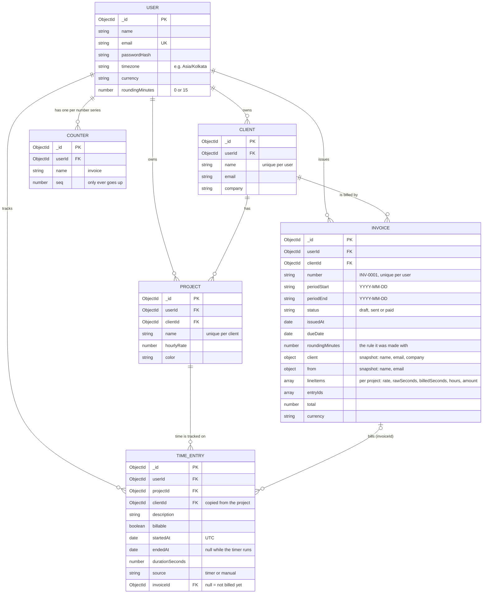

# TimeLedger

A time tracker with invoicing for freelancers: track time with a timer that lives on the server, turn unbilled time into printable invoices, and never bill the same hour twice. Built with the MERN stack (MongoDB, Express, React, Node.js).

**Live demo:** (coming in the next step)

<table>
  <tr>
    <td width="50%"><a href="docs/test-evidence/screenshots/step-8-seed-and-rounding/01-demo-dashboard-desktop.png"></a><br><sub><b>Dashboard</b>: start a timer, today's entries, this week</sub></td>
    <td width="50%"><a href="docs/test-evidence/screenshots/step-8-seed-and-rounding/02-demo-timesheet-desktop.png"></a><br><sub><b>Timesheet</b>: hours per project per day</sub></td>
  </tr>
  <tr>
    <td width="50%"><a href="docs/test-evidence/screenshots/step-8-seed-and-rounding/05-demo-invoice-sent-desktop.png"></a><br><sub><b>Invoice</b>: printable, Print / Save as PDF</sub></td>
    <td width="50%"><a href="docs/test-evidence/screenshots/step-8-seed-and-rounding/15-running-timer-top-bar-mobile.png"></a><br><sub><b>Phone</b> (375px): running timer in the top bar</sub></td>
  </tr>
</table>

More screenshots, every test result and the test code are in [docs/test-evidence](docs/test-evidence) (open [test-report.html](docs/test-evidence/test-report.html) in a browser for the whole report on one page).

## Contents

[Demo login](#demo-login) · [Features](#features) · [Tech stack](#tech-stack) · [Setup and run](#setup-and-run) · [Data model](#data-model) · [Design decisions](#main-design-decisions) · [Tests](#tests) · [Finished and not finished](#what-is-finished-and-what-is-not) · [AI tools used](#ai-tools-used) · [API](#api) · [Project structure](#project-structure) · [Troubleshooting](#troubleshooting)

## Demo login

Run `npm run seed` in `backend/` (see [Setup and run](#setup-and-run)) and log in with:

| Email | Password |
| --- | --- |
| `demo@timeledger.app` | `Demo@1234` |

The demo user, Alex Morgan (time zone Asia/Kolkata, USD), has 3 clients (Acme Corp, Globex Ltd, Initech), 4 projects, about four weeks of time entries placed relative to today, a **paid** invoice for Globex and a **sent** invoice for Acme. The last two weeks are left unbilled, so you can create an invoice right away. Nothing is running: start a timer yourself. To try the rounding rule, see [Rounding](#rounding-each-entry-up-to-15-minutes).

## Features

**Core**

- [x] **Accounts**: register and log in (bcrypt-hashed passwords, JWT), protected routes, the session survives a reload
- [x] **Clients** and **projects** (hourly rate, colour); every record belongs to one user and someone else's record answers `404`
- [x] **Timer**: start and stop on a project, with a running indicator in the sidebar (top bar on phones) and in the browser tab title
- [x] **Time entries**: add by hand (billable or not), edit and delete; filters (date range, client, project, billable, billed/unbilled) with totals, grouped by day
- [x] **Invoices**: pick a client and a period (quick picks or custom dates), see a live preview of exactly what will be billed, create it; entries on an invoice are locked
- [x] **Printable invoice**: a white A4-style page, **Print / Save as PDF** hides the sidebar, bars and buttons
- [x] **Invoice status**: Draft → Sent → Paid; delete a draft to give its entries back (invoice numbers are never reused)
- [x] **Time zones**: everything is stored in UTC and days, weeks and invoice periods follow your own time zone (daylight saving included)
- [x] **Responsive**: sidebar on desktop, top bar and bottom tab bar on phones (checked at 375px)
- [x] **Settings** page and **demo seed data** (`npm run seed`)

**The two points that were evaluated closely**

- [x] **The timer lives on the server**: correct after a refresh, after closing the browser and on another device; only one timer per user, guaranteed by the database
- [x] **An entry can never be on two invoices**, not even when two requests arrive at the same moment (claim-first update inside a transaction; concurrency tests and a mutation check)

**Stretch features**

- [x] **Rounding rule**: optionally round each entry up to 15 minutes, only when billing
- [x] **Weekly timesheet**: hours per project per day, Monday to Sunday, with daily and weekly totals; an entry that crosses midnight is split between the days

### Rounding each entry up to 15 minutes

Go to **Settings**, switch on *Round each entry up to 15 minutes* and save. From then on, creating an invoice rounds **each entry** up to the next 15 minutes (7 min → 15 min, 22 min → 30 min; exactly 15 min stays 15 min; one second more goes to 30). The new-invoice preview says *Rounded up to 15 min per entry* and shows the tracked and the billed time; the invoice page shows the same note and, per entry, `7m → 15m`. Your tracked time is never changed, and invoices you made earlier are not affected by switching it on or off.

## Tech stack

- **Backend:** Node.js (ES modules), Express 5, MongoDB with Mongoose 9, Zod 4 (validation), JSON Web Tokens, bcryptjs, Luxon (time zone maths)
- **Frontend:** React 19, Vite, Tailwind CSS 4, React Router, Axios, lucide-react icons, react-hot-toast
- **Tests:** Jest, Supertest and mongodb-memory-server (backend); Puppeteer driving Microsoft Edge (browser checks)

## Setup and run

**Prerequisites:** Node.js 20+ (20.19+ or 22.12+ for the current Vite) and a MongoDB database that supports **transactions**: a free [MongoDB Atlas](https://www.mongodb.com/atlas) cluster, or a local MongoDB running as a **replica set**. Invoices are created in a transaction (that is what makes double billing impossible); a plain local `mongod` answers `503` when an invoice is created.

1. **Get the code and install**

   ```bash
   git clone https://github.com/jagga-123/timeledger.git
   cd timeledger/backend && npm install
   cd ../frontend && npm install
   ```

2. **Configure the backend**: copy `backend/.env.example` to `backend/.env` (`cp` on macOS/Linux, `copy` on Windows) and fill in `MONGODB_URI` and `JWT_SECRET`.

   - *Atlas:* paste your connection string, with the database name, for example `mongodb+srv://<user>:<password>@<cluster>/timeledger`.
   - *Local MongoDB as a replica set:* start it with `mongod --replSet rs0 --dbpath <folder>`, run `rs.initiate()` once in `mongosh`, and use `mongodb://127.0.0.1:27017/timeledger?replicaSet=rs0`.

3. **(Optional) create the demo data**

   ```bash
   cd backend
   npm run seed
   ```

   It prints what it created. Run it as often as you like: it deletes and recreates **only** the demo user's data and never touches anybody else's. It refuses to run when `NODE_ENV=production` unless `SEED_ALLOW=true` is also set.

4. **Start the app** (two terminals)

   ```bash
   cd backend  && npm run dev    # API on http://localhost:5000  (check http://localhost:5000/api/health)
   cd frontend && npm run dev    # app on http://localhost:5173
   ```

   Open http://localhost:5173, then register, or log in as the [demo user](#demo-login).

5. **Run the tests:** `cd backend && npm test` (uses a throwaway in-memory database, never yours).

### Environment variables

`backend/.env` (the same variables as `backend/.env.example`)

| Variable | Required | Example value in `.env.example` | Description |
| --- | --- | --- | --- |
| `PORT` | no | `5000` | API port |
| `MONGODB_URI` | yes | `mongodb://127.0.0.1:27017/timeledger` | MongoDB connection string, with the database name. Use Atlas or a replica set (see above) |
| `JWT_SECRET` | yes | `replace-with-a-long-random-string` | Long random string used to sign tokens |
| `JWT_EXPIRES_IN` | no | `7d` | How long a login lasts |
| `FRONTEND_URL` | no | `http://localhost:5173` | Allowed CORS origin: the address of the frontend |
| `DNS_SERVERS` | no | *(empty)* | Comma-separated DNS servers used to look up `mongodb+srv://` hosts; empty means `8.8.8.8,1.1.1.1` |

`frontend/.env` (the same variable as `frontend/.env.example`)

| Variable | Required | Example value in `.env.example` | Description |
| --- | --- | --- | --- |
| `VITE_API_URL` | no | `http://localhost:5000/api` | API base URL including `/api` |

`NODE_ENV` and `SEED_ALLOW` are only read by `npm run seed` (see step 3). Never commit a real `.env`: it is git-ignored, and `.env.example` only contains placeholders.

### Scripts

| Where | Command | What it does |
| --- | --- | --- |
| `backend/` | `npm run dev` | Start the API with auto-restart (nodemon) |
| `backend/` | `npm start` | Start the API |
| `backend/` | `npm run seed` | Create or reset the demo user and her data |
| `backend/` | `npm test` | Run the backend tests |
| `frontend/` | `npm run dev` | Start the Vite dev server |
| `frontend/` | `npm run build` | Production build into `dist/` |
| `frontend/` | `npm run preview` | Serve the production build locally |

## Data model



- **User**: the account and its settings: time zone (follows the device), currency and the rounding rule.
- **Client** and **Project**: what the time is for. A project has the hourly rate; a client name is unique per user and a project name unique per client (case-insensitive).
- **TimeEntry**: one block of time. A **running timer is an entry with `endedAt: null`**; `invoiceId` is `null` until the entry is billed, and an entry with an invoice cannot be edited or deleted.
- **Invoice**: the bill. It stores a **snapshot** (client, sender, rates, lines, period, time zone, rounding rule), so later changes to a client or a rate never change it, plus the ids of the entries it contains.
- **Counter**: one per user, the last invoice number handed out.

## Main design decisions

- **The timer lives on the server.** The running timer is a time entry with `endedAt: null`, so it is correct after a refresh, after closing the browser and on another device. A *partial unique index* (one entry per user where `endedAt` is null) makes the **database** guarantee one timer per user, even if two devices press Start at the same moment (the loser gets `409`). `startedAt` comes from the server's clock, and the browser works out the elapsed time as `now - startedAt` corrected by the offset between its clock and the server's (every response carries `serverTime`), so a device with a wrong clock still shows the right time. It re-syncs when the tab becomes visible again and every 30 seconds, so a timer stopped on another device shows up. Stop is one atomic update that only matches a still-running timer.
- **No double billing.** Creating an invoice first **claims** the entries with one `updateMany` whose filter only matches entries that are still unbilled (`invoiceId: null`) and sets their `invoiceId`; then it builds the invoice from exactly the entries it claimed. The claim, the next invoice number and the invoice are saved in **one MongoDB transaction**, so it is all or nothing. Why not "read the entries, then mark them"? Two simultaneous requests would read the same entries and both bill them; with the claim, one of them finds nothing left (`400`). Billed entries are locked. This is covered by concurrency tests (two identical requests, eight at once, overlapping periods) and a mutation check, see [Tests](#tests).
- **Time zones.** Times are stored in UTC; days, weeks and invoice periods are computed in the user's own time zone with Luxon's calendar arithmetic (not "24 hours × days"), so a daylight saving day is correctly 23 or 25 hours long and an entry that crosses midnight is split between the two days in the timesheet. The server never uses its own zone for this.
- **Invoices are snapshots; numbers come from a counter; rounding happens at billing time.** Invoices copy the client, the sender, the rates and the lines, so history never changes. Numbers (`INV-0001`...) come from a per-user counter incremented inside the same transaction, so they are never reused, even after a draft is deleted. Each line is `hours × rate` rounded to cents and the total is the sum of those rounded lines, so the printed lines always add up. The rounding rule is applied only when an invoice is created: the entries keep their real durations, and the invoice stores the rule plus `rawSeconds` and `billedSeconds` per line.
- **Validation and privacy.** Every route validates its input with Zod and answers errors in one shape, `{ message, errors? }`. Every record has an owner and a record that is someone else's looks like a missing one (`404`), so nobody can find out what exists.

## Tests

```bash
cd backend && npm test
```

**157 backend tests** (Jest + Supertest) on a throwaway in-memory MongoDB, so they never touch a real database. The invoice and seed tests use an in-memory *replica set* because they need transactions.

| File | Tests | Covers |
| --- | --- | --- |
| `health.test.js` | 2 | health route and JSON 404 |
| `auth.test.js` | 15 | register, login, `/me`, validation, duplicate email; `PATCH /auth/me` for time zone, name and the rounding setting |
| `clients-projects.test.js` | 18 | CRUD, duplicate names, per-user isolation, delete rules, rate validation and rounding |
| `timer.test.js` | 25 | server-side start time, one timer per user (including simultaneous requests and the index itself), stop and duration, editing the running timer |
| `entries.test.js` | 28 | manual entries, the time rules, editing and deleting, billed entries locked, filters and totals |
| `timesheet.test.js` | 24 | days and week edges, splitting across midnight, daylight saving weeks, totals |
| `invoices.test.js` | 36 | which entries are billed, line items and rounding, snapshots, **an entry never on two invoices (two identical requests, eight at once, overlapping periods, two users)**, all or nothing, the `503` without transactions, time zone day boundaries, numbering, the status flow, deleting a draft, privacy; the rounding rule on invoices |
| `rounding.test.js` | 6 | `roundUp`: 1 s → 15 min, 15 min → 15 min, 15 min 1 s → 30 min, 0 stays 0, never rounds down |
| `seed.test.js` | 3 | running the seed twice gives identical data, it leaves another user's data untouched, the production guard |

**448 browser checks** drive the real app in headless Microsoft Edge against the production build and a real backend on an in-memory database (on their own ports, so a running dev server and its real database are never touched): sign-up and login, every page on desktop and phone, the timer (refresh while running, a second tab, wrong device clocks), time entries and filters, the timesheet (including a device in New York on a daylight saving day), invoices (two tabs pressing Create at the same moment, six simultaneous API requests, printing to PDF), and the Step 8 checks (the real `npm run seed` command, expected invoice amounts worked out independently from the raw entries, the Settings page and the rounding rule). Per step: 29 (auth), 62 (layout, clients, projects), 73 (timer), 82 (time entries), 54 (timesheet), 85 (invoices), 63 (demo data, rounding, settings).

**Mutation checks** show the tests can actually fail. For each one I temporarily broke the code on purpose, ran the tests, and put the file back (checked against a hash of the original):

| Change | Result |
| --- | --- |
| Take `invoiceId: null` out of the invoice claim (so entries could be claimed twice) | 5 invoice tests fail, including all three concurrency tests |
| Round to the *nearest* 15 minutes instead of *up* (`Math.ceil` → `Math.round`) | 7 tests fail |
| Make the seed delete everybody's data instead of only the demo user's | 1 test fails (the other user's data test) |

The results, 79 screenshots, two sample invoice PDFs and the test code are in [docs/test-evidence](docs/test-evidence); what was *not* tested is listed in its [README](docs/test-evidence/README.md). Building the last step also showed the value of looking at the screenshots: the dashboard cards had been wider than a phone screen since Step 6 without any check noticing, and the checks now catch that.

## What is finished and what is not

**Finished:** everything in the [feature checklist](#features): accounts, clients and projects, the server-side timer, manual entries with filters, the timesheet, invoices with the no-double-billing guarantee and printing to PDF, time zones, the rounding rule, Settings and the demo seed.

**Not done**

- No deployment yet (see the live demo line at the top).
- Invoices are not e-mailed; "Sent" and "Paid" are set by hand. There is no online payment.
- A draft invoice cannot be edited: delete it and create it again.
- The PDF comes from the browser's *Print / Save as PDF*, not from the server.
- One currency per user (USD by default), no tax, discounts or multi-currency.
- No password reset or e-mail verification; the login token is kept in the browser's local storage.
- Long lists (entries, invoices) are loaded in one go, without pages.
- No unit tests for the React components themselves; they are covered by the browser checks. Only Microsoft Edge was tested.
- The estimates on Time entries and the Timesheet use the tracked time; the rounding rule applies on invoices.

**With more time I would**

- deploy it (Atlas, a Node host and a static frontend) and add a health check and logging;
- send invoices by e-mail with a payment link, and generate the PDF on the server so it looks the same everywhere;
- let a draft be edited, add tax and discount lines and several currencies;
- add team accounts (a workspace with several members and roles);
- add pagination, search and CSV export, and a password reset by e-mail;
- add component tests and run the browser checks in CI.

## AI tools used

I used **Claude** (Anthropic) as an AI coding assistant: to plan the build as eight steps and write the prompt for each, to write the code, the tests and the browser checks, and to run them and report the results. I reviewed every part and I understand how it works.

## API

<details>
<summary>All routes are under <code>/api</code>. Routes marked <b>auth</b> need the header <code>Authorization: Bearer &lt;token&gt;</code>. (click to open)</summary>

| Method and path | Auth | Description |
| --- | --- | --- |
| `GET /health` | no | Returns `{ "status": "ok" }` |
| `POST /auth/register` | no | Body: `name` (2-50 chars), `email`, `password` (min 8). Returns `201 { user, token }`. `409` if the email is taken |
| `POST /auth/login` | no | Body: `email`, `password`. Returns `{ user, token }`. `401` for a wrong email or password |
| `GET /auth/me` | yes | Returns `{ user }` |
| `PATCH /auth/me` | yes | Body: any of `name` (2-50), `timezone` (a real time zone name such as `Asia/Kolkata`) and `roundingMinutes` (`0` or `15`); at least one. Other fields are ignored. Returns `{ user }` |
| `GET /clients` | yes | Returns `{ clients }`, each with `projectCount` |
| `POST /clients` | yes | Body: `name` (2-80), optional `email`, `company`. Returns `201 { client }`. `409` for a duplicate name |
| `PATCH /clients/:id` | yes | Update any of the client fields. Returns `{ client }` |
| `DELETE /clients/:id` | yes | Returns `204`. `409` if the client still has projects |
| `GET /projects` | yes | Returns `{ projects }` with `client: { _id, name }`. Optional `?clientId=` filter |
| `POST /projects` | yes | Body: `name` (2-80), `clientId`, `hourlyRate` (0-10000), optional `color` (hex, default `#4F46E5`). Returns `201 { project }`. `400 Client not found` if the client isn't yours, `409` for a duplicate name |
| `PATCH /projects/:id` | yes | Update any of the project fields. Returns `{ project }` |
| `DELETE /projects/:id` | yes | Returns `204` |
| `GET /timer` | yes | Returns `{ timer, serverTime }`: the running timer (with project and client names) or `null` |
| `POST /timer/start` | yes | Body: `projectId`, optional `description` (max 200), `billable` (default true). Returns `201 { timer, serverTime }`. `400 Project not found` if the project isn't yours or is archived, `409 A timer is already running. Stop it first.` |
| `POST /timer/stop` | yes | Returns `{ entry, serverTime }` with `endedAt` and `durationSeconds`. `404 No timer is running` |
| `PATCH /timer` | yes | Change `description`, `billable` or `projectId` of the running timer only. Returns `{ timer, serverTime }` |
| `GET /entries` | yes | Finished entries (the running timer is left out), newest first, plus totals. Optional filters: `from` (inclusive) and `to` (exclusive) as ISO date-times, `clientId`, `projectId`, `billable` (`true` / `false`), `status` (`all` / `unbilled` / `billed`), and `overlap=true` to make `from`/`to` match every entry that touches the range instead of only entries that started in it. Returns `{ entries, totals: { totalSeconds, billableSeconds, billableAmount, unbilledAmount } }` |
| `POST /entries` | yes | Body: `projectId`, `startedAt`, `endedAt` (ISO timestamps, offsets allowed), optional `description` (max 200), `billable` (default true). Returns `201 { entry }` with `source: "manual"` and the project's client copied in. `400` if the end isn't after the start, the entry is longer than 24 hours, or the end is in the future (1 minute of clock difference is allowed) |
| `PATCH /entries/:id` | yes | Change any of those fields. `409 This entry is on an invoice and can't be changed` for a billed entry, `409 Stop the timer first` for the running timer |
| `DELETE /entries/:id` | yes | Returns `204`. Same `409` rules as editing |
| `GET /timesheet` | yes | Optional `weekStart` (a Monday, `YYYY-MM-DD`; defaults to the current week in your time zone, `400 Week must start on a Monday` otherwise). Returns `{ weekStart, weekEnd, timezone, days, rows, dayTotals, weekTotalSeconds, billableSeconds, billableAmount }`: `days` are 7 `{ date, label }`, each row has a project, its client and 7 `seconds` (one per day, an entry across midnight is split) plus `totalSeconds` and `billableSeconds`. The running timer is left out |
| `GET /invoices` | yes | Returns `{ invoices }`, newest first, without their lines. Optional `?status=draft\|sent\|paid` and `?clientId=` |
| `GET /invoices/:id` | yes | Returns `{ invoice, entries }`: the invoice with its lines, and the time entries on it in time order (each with `durationSeconds` tracked and `billedSeconds` billed) |
| `POST /invoices/preview` | yes | Body: `clientId`, `from`, `to` (`YYYY-MM-DD`, both days included, in your time zone). Returns `{ preview }` with the lines, total, `roundingMinutes` and entries that an invoice would contain, and saves nothing. `400` for a client that isn't yours, `from` after `to`, a period over 366 days or an end date after today, and `400 No unbilled billable time for this client in this period` when nothing matches |
| `POST /invoices` | yes | Same body plus optional `notes` (max 500). Bills the matching entries and returns `201 { invoice }` (`INV-0001`, ...). The same `400`s as the preview, which is also what a second, simultaneous request for the same entries gets. `503` if MongoDB has no transactions (a local server that isn't a replica set) |
| `PATCH /invoices/:id/status` | yes | Body: `status` (`sent` or `paid`). Draft to sent, sent to paid or draft to paid; anything else is `409 Can't change status from X to Y`. Returns `{ invoice }` |
| `DELETE /invoices/:id` | yes | Returns `204` and makes the invoice's entries unbilled again. Only drafts: `409 Only draft invoices can be deleted` |

**Errors** always look like `{ "message": "...", "errors": [{ "path": "email", "message": "..." }] }`; `errors` is only present for validation failures (`400`). A malformed `:id` returns `400 Invalid id`, a missing or invalid token returns `401`, and a record that doesn't exist or belongs to someone else returns `404`.

</details>

## Project structure

<details>
<summary>Folders and what is in them (click to open)</summary>

```
timeledger/
├── backend/
│   ├── .env.example
│   └── src/
│       ├── app.js, server.js         Express app and startup
│       ├── seed.js                   npm run seed (the command; the work is in services/seed.service.js)
│       ├── config/                   MongoDB connection
│       ├── models/                   User, Client, Project, TimeEntry, Invoice, Counter (invoice numbers)
│       ├── routes/                   auth, clients, projects, timer, entries, timesheet, invoices
│       ├── controllers/              request handlers
│       ├── services/                 timer, entries, timesheet, invoice (preview, create, status, delete), seed
│       ├── middleware/               auth, validation, error handling
│       ├── validators/               Zod schemas
│       ├── utils/                    tokens, errors, money, ids, time zones, rounding (roundUp)
│       └── tests/                    Jest tests
├── frontend/
│   ├── .env.example
│   └── src/
│       ├── api/                      axios instance and API calls
│       ├── components/               shared UI (Modal, Button, FormField, ...)
│       ├── context/, hooks/          auth and timer state
│       ├── layouts/                  AuthLayout, AppLayout (sidebar / top bar and tab bar)
│       ├── pages/                    Login, Register, Dashboard, Clients, Projects, TimeEntries, Timesheet, Invoices, InvoiceDetail, Settings
│       └── utils/                    formatting and error helpers
└── docs/
    └── test-evidence/                test report, screenshots, raw results, test code
```

</details>

## Troubleshooting

- **`503 Invoices need MongoDB transactions` when creating or deleting an invoice:** your MongoDB is a plain standalone server. Use MongoDB Atlas, or run a local MongoDB as a single-node replica set (`mongod --replSet rs0`, `rs.initiate()` once in `mongosh`, and `?replicaSet=rs0` on `MONGODB_URI`).
- **`querySrv ECONNREFUSED` when connecting to Atlas:** Node's DNS lookup failed. The app already uses public DNS servers by default. If your network blocks them, set `DNS_SERVERS` in `backend/.env` to your network's DNS.
- **`JWT_SECRET is not defined`:** copy `backend/.env.example` to `backend/.env` and set a long random value.
- **Browser shows a CORS error:** make sure `FRONTEND_URL` in `backend/.env` matches the address of the frontend (default `http://localhost:5173`).
- **Port already in use:** another copy of the app is running. Stop it, or change `PORT` / the Vite port.
- **`npm run seed` says `Refusing to seed`:** `NODE_ENV` is `production`. Set `SEED_ALLOW=true` only if you really want demo data in that database.
